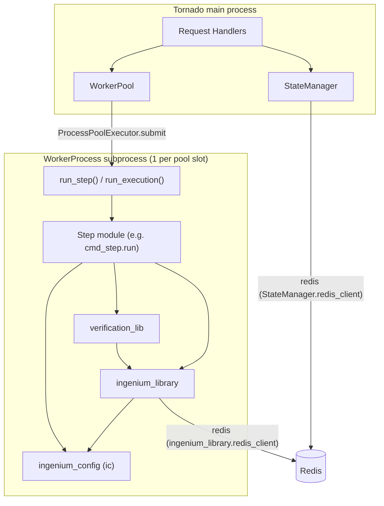
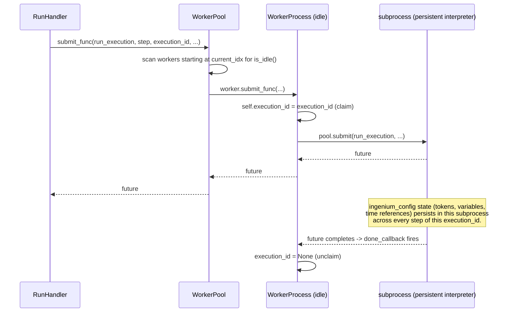
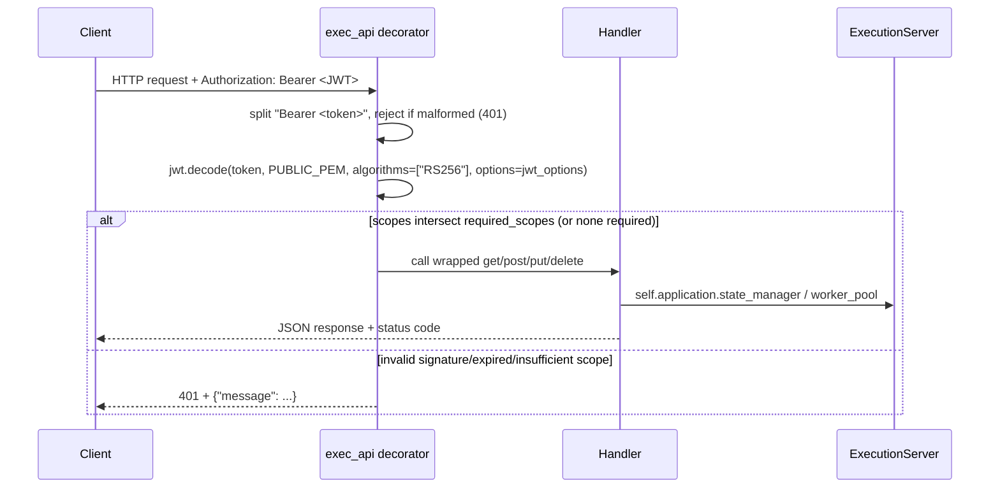
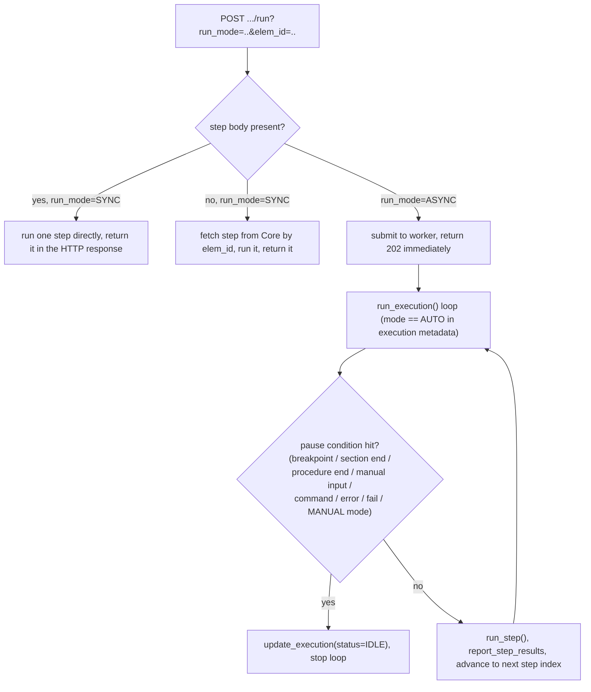

# Architecture

## Major components

| Component | File | Responsibility |
|---|---|---|
| `ExecutionServer` (Tornado `Application`) | `image/execution_server.py` | Wires HTTP routes to handlers, owns the `WorkerPool` and `StateManager`, reads config at boot. |
| Request handlers (`ExecutionHandler`, `RunHandler`, `ConfigHandler`, `VariableHandler`, `HaltHandler`, `CopyStateHandler`, `SwitchHandler`, `LoggingHandler`, `HealthHandler`) | `image/execution_server.py` | One class per route; each `get`/`post`/`put`/`delete` method is wrapped by the `exec_api` auth decorator. |
| `exec_api` decorator | `image/execution_server.py` | Verifies the Bearer JWT (RS256, `PUBLIC_PEM`), enforces scope membership, attaches `handler.jwt_token`/`jwt_decoded`/`log_dict`. |
| `WorkerPool` / `WorkerProcess` | `image/execution_server.py` | Pool of long-lived, single-worker `ProcessPoolExecutor`s; pins an execution to one OS process across steps; can forcibly restart (`reset()`) a stuck/broken worker. |
| `StateManager` | `image/state_manager.py` | Thin Redis wrapper backing the `config_value` and `variable_value` REST endpoints. |
| `ingenium_config` (`ic`) | `image/ingenium_embedded/ingenium_config.py` | Process-global **mutable** state: tokens, variables, venue info, time references, timeouts/defaults. Lives inside each worker subprocess. |
| `ingenium_library` (`ing_lib`) | `image/ingenium_embedded/ingenium_library.py` | Everything a step needs to talk to Core and the Venue Service/Venue Configuration Service; the `ing_execution` decorator; response-aggregation classes (`EhaResponse`, `EvrResponse`, `DpResponse`, `Bus1553Response`, `CustomScriptResponse`); JWT decode/refresh; error/event enums. |
| `verification_lib` | `image/ingenium_embedded/verification_lib.py` | `Verify` factory + type-specific verifiers (string/bool/int/float, including `CHANGE`/range/contains conditions); `CommandBase`/`FSWVerify`/`HWVerify`/`BinaryFileVerify` for command dispatch + post-dispatch verification; `run_eha_verification` (shared by `VERIFY_EHA`/`WAIT_EHA`). |
| Step modules (`*_step.py`) | `image/ingenium_embedded/` | One `run(step)` per step type; thin orchestration over `ingenium_library`/`verification_lib`. |

## Component dependency graph

**Key point (observed implementation, not just inference):** `StateManager`
and `ingenium_library` each open their own `redis.StrictRedis` connection —
one in the main process, one inside every worker subprocess — but both use
the identical key template `execution_id:{execution_id}` (`HASH_TEMPLATE` in
both `image/state_manager.py` and `image/ingenium_embedded/ingenium_library.py`).
They are two independent clients reading/writing the *same* logical hash per
execution. This is how a `GET /variable_value` request handled in the main
process can see a value written by a worker subprocess mid-execution.

## Process model: why a worker pool of subprocesses?

`WorkerProcess` (`image/execution_server.py`) wraps a
`ProcessPoolExecutor(max_workers=1)` — i.e. exactly one OS subprocess per
`WorkerProcess`. `WorkerPool.submit_func` round-robins across `NUMBER_OF_KERNELS_MIN`
(default 5) such workers, picking the next **idle** one (`worker.is_idle()`,
true when `worker.execution_id is None`). Once a worker is handed an
`execution_id`, it stays "claimed" until the submitted future completes (or
`cancel_run`/`reset` forcibly clears it).

This design is why the docstring/README claim that "variables, EHA/EVR time
references, and venue tokens set by one step remain available to subsequent
steps in the same execution" holds: it is a direct consequence of pinning an
execution to one persistent Python interpreter rather than spawning a fresh
process per step.

**Failure handling:** if `pool.submit` raises `BrokenProcessPool` (or any
other exception), `WorkerProcess.submit_func` calls `self.reset()`, which
`SIGTERM`s (then, after a 5s grace period, `SIGKILL`s) the old subprocess via
`psutil`/`os.kill`, recreates the `ProcessPoolExecutor`, and only then clears
`execution_id`/`run_mode`/`future` — guarded so this happens exactly once
whether triggered by `reset()` or by the future's `done_callback`.

## Request lifecycle & auth

`/api/v4/health` is the only route registered with `required_scopes=[]`
(see `HealthHandler` and the `handlers` list in `ExecutionServer.__init__`),
so it skips the `Authorization` header check entirely (`exec_api`'s `else`
branch at the bottom of the decorator).

## Control flow: SYNC vs ASYNC vs AUTO

`RunHandler.post` always mints a fresh venue-service JWT
(`exec_venue_jwt_encoded`, 1-hour expiry) and stores it plus the caller's own
Ingenium JWT into Redis via `StateManager`, then submits `run_execution` to
the `WorkerPool`. What happens next depends on `run_mode` and whether a
`step` body was supplied:

The full branching logic — including nested `PROCEDURE_SECTION` handling
(`call_procedure_section`/`import_procedure_section`/`suspend_resume_execution`
/`switch_execution`) and parent-execution resumption when a child execution
runs out of elements — lives entirely in `run_execution()` in
`image/execution_server.py`. See [Data Flows](Data-flows.md) for a
narrated walkthrough and [Core Components](Core-components.md) for the
helper functions it calls (`get_next_step_idx`, `needs_approval`,
`requires_manual_input`, `is_command_step`).

## Step dispatch

`run_step(step)` (`image/execution_server.py`) resolves which Python function
actually executes a step: it splits `step['code']['name']` (e.g.
`"cmd_step.run"`) on `.` into `module_name` / `function_name`, imports
`ingenium_embedded.{module_name}` with `importlib.import_module`, and calls
`getattr(module, function_name)(step)`. This means **dispatch is driven by
the `code.name` field set by Core, not by `step_type` directly** — the
`step_type` enum in `execution.yaml` documents the supported categories, but
the actual routing convention is "one module per step family, function
usually named `run`". See [API Reference](Api-reference.md#step-dispatch-convention).
