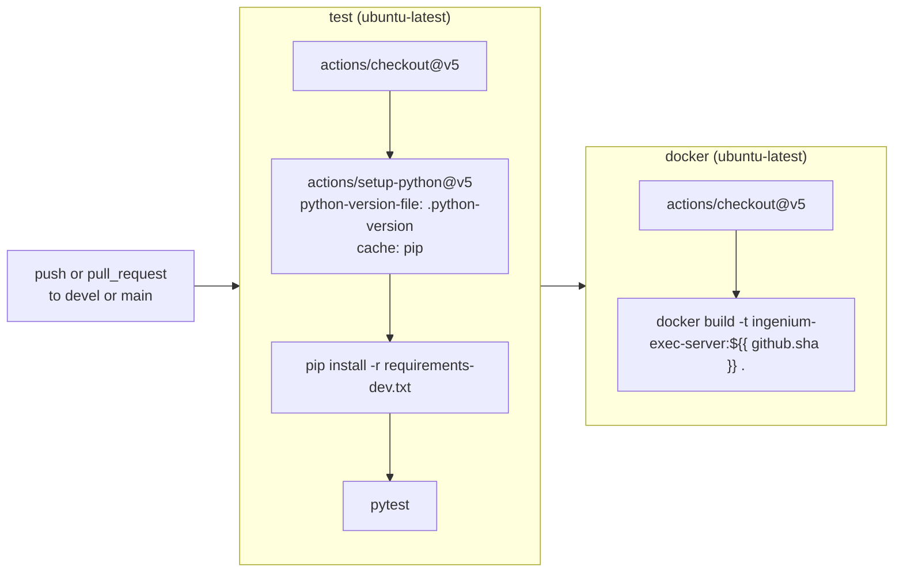

# CI/CD

This repository uses GitHub Actions (`.github/workflows/ci.yml`) as its CI
system — the public, source-of-truth test gate.

## GitHub Actions (`.github/workflows/ci.yml`)

- **Triggers**: `push` and `pull_request`, both restricted to `branches:
  [devel, main]`.
- **Permissions**: `contents: read` only (no write access requested).
- **Concurrency**: `group: ${{ github.workflow }}-${{ github.ref }}`,
  `cancel-in-progress: true` — a new push to the same ref/PR cancels any
  still-running run for that ref.
- **Job `test`**: Python version comes from `.python-version` (currently
  `3.14`), pip cache enabled via `setup-python`'s `cache: pip`. Runs
  `pytest` with no extra flags — i.e. the full `pyproject.toml`-configured
  suite including coverage generation (but no coverage gate, since
  `--cov-fail-under` is unset).
- **Job `docker`**: depends on `test` (`needs: test`) — will not run if
  tests fail. Builds the image tagged with the commit SHA
  (`ingenium-exec-server:${{ github.sha }}`); this is a **build smoke test
  only** — the image is not pushed to any registry, run, or otherwise
  verified beyond a successful `docker build`.

There is no separate lint/format/type-check job, no release/publish job, and
no matrix build (single OS, single Python version) in this workflow.

## Practical implications for contributors

- A PR against `devel` or `main` must pass `pytest` (GitHub Actions `test`
  job) and produce a buildable Docker image (`docker` job) before merge
  gating would normally apply (branch protection rules themselves are not
  part of this repository and are not documented here).
