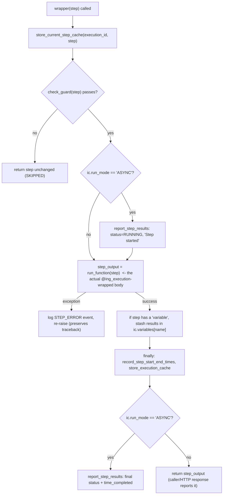

# Core Components

## `image/execution_server.py`

The Tornado application. Everything the process does on boot and per-request
lives here.

### `ExecutionServer(tornado.web.Application)`
- Reads `NUMBER_OF_KERNELS_MIN` (env, default `5`) and builds a `WorkerPool`
  of that size.
- Reads `REDIS_HOST`/`REDIS_PORT` (env, falling back to `config.ini`'s
  `[redis]` section) and constructs one `StateManager`.
- Registers the route table (see [API Reference](Api-reference.md)).
- Instantiated once in the `if __name__ == '__main__':` block, which also
  reads `config.ini`, sets the `Global` logger's level from `LOG_LEVEL`
  (env or `config.ini`), starts the `tornado.httpserver.HTTPServer` on
  `HTTP_PORT` (env or `config.ini`), optionally enables `tornado.autoreload`
  when `DEV=true`, and calls `IOLoop.current().start()`.

### `WorkerProcess`
Wraps exactly one `ProcessPoolExecutor(max_workers=1)`. Public surface:
- `submit_func(func, step, execution_id, elem_id, user_name, run_mode)` —
  claims the worker (`self.execution_id = execution_id`), submits `func` to
  the subprocess, registers `done_callback` to release the claim, and
  self-heals (`reset()`) on `BrokenProcessPool` or any submit-time exception.
- `is_idle()` — `True` iff `self.execution_id is None`.
- `reset()` — `SIGTERM`s the subprocess, polls `psutil.pids()` for up to 5s,
  escalates to `SIGKILL` if needed, then rebuilds the pool via `_init_pool()`.
  Guarded so execution/run_mode/future are cleared exactly once even if a
  `done_callback` fires concurrently.

### `WorkerPool`
- `submit_func(...)` — round-robins from `self.current_idx`, returns the
  first idle worker's future; raises `Exception('No worker is available')`
  if none are idle.
- `switch_execution(execution_id, target_execution_id)` — reassigns a
  **busy** worker's claimed `execution_id` in place (used when a parent
  execution hands control to/from a child procedure section — see
  `run_execution`'s `PROCEDURE_SECTION` handling).
- `cancel_run(execution_id)` — finds the worker currently claimed by
  `execution_id`, calls `worker.reset()`, and returns `(True, run_mode)`;
  returns `(False, None)` if no such worker is busy. Backs `HaltHandler`.

### `exec_api(*, required_scopes=[], event='', description='')`
Decorator factory applied to every handler method. If `required_scopes` is
non-empty it requires an `Authorization: Bearer <jwt>` header, decodes it
with `jwt.decode(token, public_pem, algorithms=['RS256'], options=jwt_options)`
(`jwt_options` disables `verify_nbf`/`verify_aud`, enables the rest), checks
that the token's `scopes` claim intersects `required_scopes`, and only then
calls the wrapped function — attaching `handler.jwt_token`, `handler.jwt_decoded`,
and `handler.log_dict` first. With an empty `required_scopes` list, auth is
skipped entirely (used only by `HealthHandler`).

### `RequestLogHandler(RequestHandler)`
Base class for every handler. Overrides `finish()` to log the response via
the module logger: successful `GET`s are not logged (to avoid noisy polling
logs), everything else logs `self.log_dict` (populated by `exec_api`) at
`INFO` (2xx) or `ERROR` (otherwise), including the parsed response body under
`data` when present.

### Standalone functions
- `run_step(step)` — dynamic dispatch by `step['code']['name']`; see
  [Architecture § Step dispatch](Architecture.md#step-dispatch).
- `run_execution(step, execution_id, elem_id, user_name, run_mode)` — the
  single-step (`SYNC`) and multi-step AUTO-loop (else) entry point submitted
  to the worker pool. See [Data Flows](Data-flows.md) for the full
  narrative.
- `get_step_idx`, `get_next_step_idx`, `needs_approval`,
  `requires_manual_input`, `is_command_step` — pure helpers used by
  `run_execution` to locate/gate the next runnable element. These are the
  functions covered directly by `tests/unit/test_execution_server.py`.
- `stop_execution_with_error(execution_id, msg)` — posts an `ERROR`-level
  execution message to Core and marks the execution `IDLE`.

## `image/state_manager.py`

`StateManager` is a minimal Redis façade with three methods, all keyed by
`execution_id:{execution_id}` (`HASH_TEMPLATE`):
- `set_config_value(execution_id, key, value_str)` → `HSET`.
- `get_config_value(execution_id, key)` → `HGET`, decoded from bytes, or
  `None`.
- `get_variable_value(execution_id, var_name)` → reads the whole
  `manual_input_variables` hash field, `json.loads`-decodes it, and returns
  `dict.get(var_name)`.
- `delete_execution(execution_id)` → `DEL` on the whole hash.

This is intentionally the *only* Redis surface the main Tornado process
touches directly (`RunHandler` also writes `venue_token`/`ing_token`/`run_mode`
through it before submitting a step).

## `image/ingenium_embedded/ingenium_config.py` (`ic`)

A plain module used as global mutable state — every step module and library
function imports it as `ic` and reads/writes its attributes directly (there
is no class wrapper). Categories of state, as grouped in the source:

- **Exec-managed** (set by the Execution Server / `ing_execution` around each
  step): `username`, `variables`, `environment_step_variables`,
  `manual_input_variables`, `channel_variables`, `cmd_variables`,
  `mil_1553_variables`, `ing_token`, `venue_token`, `run_mode`,
  `last_step_status`, `time_references` (pre-seeded with
  `LAST_STEP_START/END`, `LAST_FSW_CMD_STEP_START/END`, etc.),
  `execution_id`, `venue_service_address`, `venue_sse`, `venue_name`,
  `venue_id`, `venue_type`, `ingenium_address`.
- **Library/step-managed**: `ampcs_session_information` (list of
  `{data_path, session_id}` maps registered by GDS/manual steps and consumed
  by MTAK/command verification).
- **Constants/defaults**: per-query-type timeouts (`eha_rt_timeout`,
  `evr_rt_timeout`, `bus_1553_timeout`, `custom_script_timeout`,
  `cmd_timeout`, `mtak_timeout`, `dp_timeout`, `*_chill_timeout`),
  `default_lookback`, `rest_timeout`, `chill_query_frequency`,
  `query_trial_intervals` (`[1, 2, 4, 8, 16]` seconds — exponential retry
  backoff), `header` (base REST headers dict), `ssl_verify` (hardcoded
  `False`), API version segments (`venue_service_version="v3"`,
  `venue_config_version="v1"`, `core_service_version="v5"`,
  `exec_server_version="v4"`), `cmd_delay_seconds`.
- **AWS/env-derived**: `media_bucket` = `MEDIA_BUCKET` env var,
  `file_server_api_host` = `FILE_SERVER_API_HOST` env var.
- **Command-dispatch verification channels**, each independently overridable
  via env var (see [Configuration](Configuration.md)): `fsw_channels`,
  `fsw_evr_name`, `hw_channels`, `hw_evr_name`, `binary_file_channels`,
  `binary_file_evr_name`, `verify_evr_msg`.

Because this state is process-global, **it is only safe because each
execution is pinned to its own worker subprocess** (see [Architecture](Architecture.md)).
The unit-test suite's `reset_ingenium_config` autouse fixture
(`tests/unit/conftest.py`) exists specifically to snapshot/restore this
module between tests so they don't leak state into each other.

## `image/ingenium_embedded/ingenium_library.py` (`ing_lib`)

The largest module (~4,400 lines). Logical groups:

- **Enums**: `ErrorType`, `ErrorSource`, `EventName` — the controlled
  vocabularies used in every structured log/error payload. See
  [Error Handling](Error-handling.md).
- **Execution cache (Redis)**: `store_execution_cache`,
  `reload_execution_cache`, `store_current_step_cache`,
  `get_current_step_cache`, `store_custom_script_session_id`,
  `copy_execution_state`, `wait_execution_switch` — all keyed off the same
  `execution_id:{execution_id}` hash `StateManager` uses, via a
  module-level `redis_client` (`redis.StrictRedis(host=REDIS_HOST or
  'exec_redis', port=REDIS_PORT or 6379)` — note the different default host
  than `state_manager`'s, see [Configuration](Configuration.md)).
- **Core API client functions** (all call `refresh_ingenium_token()` first,
  then `get_ing_authorization_header()`, then hit `CORE_SERVER` at
  `core_service_version` `"v5"`): `update_execution`, `get_execution`,
  `get_element`, `get_simple_elements`, `get_execution_step`, `compute_step`,
  `create_new_run`, `import_procedure_section`, `call_procedure_section`,
  `switch_execution` (hits `EXECUTION_SERVER`, not Core — cross-worker
  handoff), `suspend_resume_execution`, `post_execution_message`,
  `report_step_results`/`report_step_results2` (POST step results to Core).
- **`ing_execution(run_function)`** — the decorator every step module's
  `run` is wrapped in. See below.
- **JWT lifecycle**: `decode_ingenium_token`/`decode_venue_token` (verify
  against `PUBLIC_PEM`/`EXEC_VENUE_PUBLIC_PEM`), `refresh_venue_tokens`/
  `refresh_ingenium_token` (decode unverified — tolerating an already-expired
  token — re-stamp `iat`/`exp` = now+30min, re-sign with
  `EXEC_VENUE_PRIVATE_PEM`/`PRIVATE_PEM`, cache in Redis).
- **Venue query/command functions**: `ChillEVRQuery`, `ChillEHAQuery`,
  `CommandFSW`, `CommandHW`, `CommandSCMF`, `CommandBinaryFile`, `CommandSSE`,
  `StartMTAK`/`ShutdownMTAK`, `DataProductsQuery`, `RealtimeEHA`/`RealtimeEHAs`,
  `RealtimeEVR`, `query_bus_1553`. Nearly all share the retry pattern
  described in [Data Flows § Retry/backoff pattern](Data-flows.md).
- **Response-aggregation classes**: `EhaResponse`, `EvrResponse`,
  `DpResponse`, `Bus1553Response`, `CustomScriptResponse` — each wraps the
  original `execution_user_input` entries and exposes
  `update_*_entry`/`return_intermediate_response` so steps can report partial
  progress (`ASYNC` mode / long polling) without losing the original request
  shape.
- **Custom script + file transfer**: `start_custom_script`,
  `get_script_status`, `halt_script`, `construct_object_name`,
  `upload_file_to_fileserver` (boto3 `put_object` to `MEDIA_BUCKET`),
  `process_cs_files` (downloads a `.tar` log bundle from the venue, extracts
  it, uploads members to S3/file server, returns a fileserver URL + parsed
  `output.json`).
- **Misc utilities**: `dict_digest`/`dict_digest_str` (log-safe step
  summaries), `get_now_utc`/`to_utc_str`/`convert_time`/`parse_to_doy` (time
  formatting for AMPCS's day-of-year time strings), `create_step_error`/
  `return_step_with_error`/`StepExecutionError`, `validate_times` (resolves
  step time-window inputs, including named references like
  `LAST_STEP_START`), `get_venue_config`/`update_venue_config` (Venue
  Configuration Service client), `register_session`/`get_session_information`
  (data-path → AMPCS session-id registry backed by `ic.ampcs_session_information`).

### `ing_execution` decorator — what every step gets "for free"

Every step module's `run` therefore does **not** need to talk to Core for its
own start/end bookkeeping in `ASYNC` mode — only for *intermediate* progress
(e.g. the polling loops in `custom_script_step.run` and
`verification_lib.run_eha_verification` call `report_step_results` explicitly,
independent of `run_mode`).

## `image/ingenium_embedded/verification_lib.py`

- **`Verify` (factory) / `VerificationBase`** — `Verify.factory(step, query,
  value_type, eha_response=None, environment_type=None)` returns a
  `VerifyString`/`VerifyBoolean`/`VerifyInteger`/`VerifyFloat` instance based
  on `value_type`. Each subclass's `verify()` evaluates the entry's
  `verification_condition` (`EQUAL`, `NOT_EQUAL`, `GREATER_THAN`,
  `INCLUSIVE_RANGE`, `CONTAINS`, `RECORD`, `NOT_PRESENT`, `CHANGE`, ...)
  against `data_type_mapping` (which conditions are legal for which type) and
  returns `(query_result, actual_value, verification_status)`.
- **`CommandBase` / `FSWVerify` / `HWVerify` / `BinaryFileVerify`** —
  `CommandBase.verify_command()` records "before" EHA telemetry, dispatches
  the command via the subclass's `dispatch_cmd()`, then re-queries EHA/EVR to
  confirm dispatch/verification within the entry's `timeout` (tracked via
  `get_remaining_seconds`). Used by `cmd_step.run` for `hw_fsw == "FSW"/"HW"`
  entries with `verify == True`.
- **`run_eha_verification(step, wait)`** — shared implementation behind both
  `VERIFY_EHA` (`wait=False`, checks once/until every channel reports at
  least once) and `WAIT_EHA` (`wait=True`, polls until every entry reports
  `PASS` or the time window elapses). See [Data Flows](Data-flows.md) for
  the full loop.
- **`verify_query_evr_results` / `verify_data_product_condition`** — the EVR-
  and data-product-specific analogues used by `query_evr_step.py`/
  `wait_evr_step.py`/`list_data_products_step.py`/`wait_data_products_step.py`.

## `image/ingenium_embedded/ingenium_step_sdk.py`

Login/venue-listing helpers (`set_login_info`, `login`, `refresh`, `logout`,
`get_venues`) built around interactive `input()`/`getpass.getpass()` or a
`USERNAME`/`PASSWORD` env-var pair. **Not imported by `execution_server.py`
or any step module** — it appears intended for ad-hoc scripts/interactive use
against `ic.ingenium_address`, separate from the server's own JWT flow. The
repository does not document a caller for this module.

## `image/ingenium_embedded/logging_util.py` & `json_log_config.py`

`logging_util.py` creates the module logger (`logging.getLogger(__name__)`)
used throughout `ingenium_embedded`, adds a `stderr` stream handler, and sets
its level from `ic.loglevel`. `json_log_config.py` defines `CustomJSONLog`, a
`logging.Formatter` that emits one JSON object per record — always including
`timestamp`, `level`, `message`, `service: "EMBEDDED_CODE"`, `user_name`
(from `ic.username`), and, when present on the record, `event`/`data`
(merging in exception details under `data.details`). `logger_init()` wires
this formatter into `json_logging.init_non_web`.

## Step modules — catalog

Every module below follows the same shape: `@ing_execution def run(step):
... return step`, mutating `step['execution']['results']` and
`step['execution']['meta_data']['status']`/`status_message`, and calling
`return_step_with_error(step, error_obj)` on failure. Most also define a
`run_dummy(step)` used only when a test harness sets
`ic.manual_input_variables['step_function_name']['actual_value'] ==
"run_dummy"` (a convention used to fake venue responses without a real
venue — see e.g. `cmd_step.py`, `check_config_step.py`, `gds_manual_step.py`).

| Step type (per `execution.yaml`) | Module | Delegates to |
|---|---|---|
| `CMD` | `cmd_step.py` | `verification_lib.FSWVerify`/`HWVerify`, `ingenium_library.CommandFSW`/`CommandHW` |
| `CMD_FILE` | `cmd_file_step.py` | `ingenium_library.CommandBinaryFile` |
| `CMD_SCMF` | `cmd_scmf_step.py` | `ingenium_library.CommandSCMF` |
| `CMD_SSE` | `cmd_sse_step.py` | `ingenium_library.CommandSSE` |
| `CUSTOM_SCRIPT` | `custom_script_step.py` | `ingenium_library.start_custom_script`/`get_script_status`/`process_cs_files`/`halt_script`, `CustomScriptResponse` |
| `VERIFY_EHA` | `verify_eha_step.py` | `verification_lib.run_eha_verification(step, wait=False)` |
| `WAIT_EHA` | `wait_eha_step.py` | `verification_lib.run_eha_verification(step, wait=True)` |
| `QUERY_EVR` | `query_evr_step.py` | `ingenium_library.RealtimeEVR`/`ChillEVRQuery`, `verification_lib.verify_query_evr_results` |
| `WAIT_EVR` | `wait_evr_step.py` | same as `QUERY_EVR`, polling until pass/timeout |
| `GRAPH_EHA` | `graph_eha_step.py` | `ingenium_library.RealtimeEHA`/`ChillEHAQuery` (no PASS/FAIL verification — data collection only) |
| `LIST_DATA_PRODUCTS` | `list_data_products_step.py` | `ingenium_library.DataProductsQuery` |
| `WAIT_DATA_PRODUCTS` | `wait_data_products_step.py` | `DataProductsQuery` + `verification_lib.verify_data_product_condition`, polling |
| `BUS_1553` | `bus_1553_step.py` | `ingenium_library.query_bus_1553`, `Bus1553Response`, `verification_lib.Verify` |
| `MANUAL_INPUT` | `manual_input_step.py` | `verification_lib.Verify.factory` on user-supplied `actual_value` |
| `MANUAL_INPUT` (with artificial delay) | `manual_input_step_with_sleep.py` | none — sleeps 10s, used for testing async/halt behavior |
| `MANUAL_EIP` | `manual_eip_step.py` | unit conversion (`convert_units`) + verification |
| `MANUAL_VERIFICATION` | `manual_verification_step.py` | pass-through PASS/FAIL recording |
| `ENVIRONMENT_MANUAL` | `environment_manual_step.py` | `verification_lib.Verify` (temperature/humidity conditions) |
| `GDS_MANUAL` | `gds_manual_step.py` | `ingenium_library.ShutdownMTAK`/`StartMTAK`/`register_session` |
| `VENUE_CONFIG_MANUAL` | `venue_config_manual_step.py` | none — records user input as-is |
| `VENUE_CONFIG_GET` | `get_config_step.py` | `ingenium_library.get_venue_config` |
| `VENUE_CONFIG_UPDATE` | `update_config_step.py` | `ingenium_library.update_venue_config` |
| `VENUE_CONFIG_CHECK` | `check_config_step.py` | `ingenium_library.get_venue_config` + local comparison |
| `WAIT` | `wait_step.py` | timed wait against `LAST_*` time references (no venue call) |
| (test/reference helper) | `time_reference_step.py` | records/returns `ic.time_references` |

See [API Reference](Api-reference.md) for the shared step envelope schema
and [Extending the System](Extending.md) for how to add a new one.
