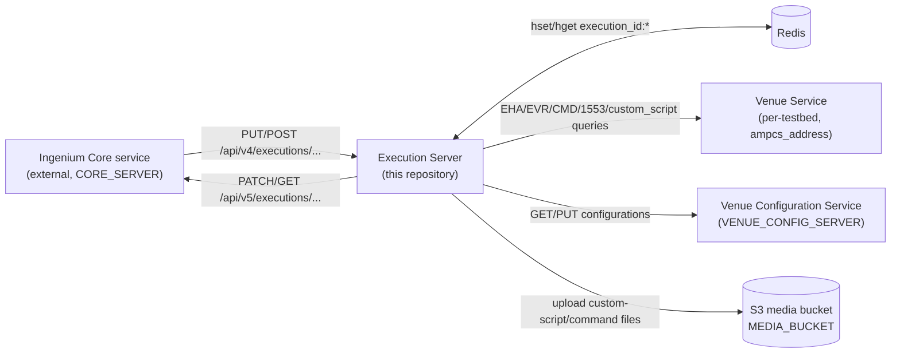

# Project Overview

## What this system does

The Execution Server is a **Tornado-based REST service** (`image/execution_server.py`)
that runs individual "procedure step" payloads on behalf of the Ingenium
test-automation platform. Callers (the Ingenium **Core** service, in practice)
register an *execution* against a test venue, then repeatedly `POST` steps for
the server to run. Each step is a JSON document describing one testable action
— send a command, wait for a channel value, poll a custom script, collect a
manual input, etc. — and the server returns (or asynchronously reports) the
same document annotated with results and a `PASS`/`FAIL`/`ERROR` status.

The system does **not** implement test procedures, telemetry storage, or the
web UI. It is the execution *engine*: given one step at a time, it talks to a
**Venue Service** (the AMPCS/GDS-facing service for a specific testbed) and a
**Venue Configuration Service**, and reports outcomes back to **Core**.

## Major capabilities

Grounded in `image/ingenium_embedded/` and `execution.yaml`:

- **Broad step-type support.** 20+ step modules, each a thin `run(step)`
  entry point: commanding (`CMD`, `CMD_FILE`, `CMD_SCMF`, `CMD_SSE`), EHA/EVR
  telemetry verification and waiting (`VERIFY_EHA`, `WAIT_EHA`, `WAIT_EVR`,
  `QUERY_EVR`, `GRAPH_EHA`), data products (`LIST_DATA_PRODUCTS`,
  `WAIT_DATA_PRODUCTS`), 1553 bus verification (`BUS_1553`), venue
  configuration (`VENUE_CONFIG_GET/UPDATE/CHECK/MANUAL`), manual/GDS/EIP
  human-input steps, and arbitrary `CUSTOM_SCRIPT` execution on the venue.
  See [Core Components](Core-components.md).
- **Stateful worker-process pool.** Each execution is pinned to one long-lived
  Python subprocess (`WorkerProcess` / `ProcessPoolExecutor(max_workers=1)` in
  `image/execution_server.py`), so module-level state in `ingenium_config`
  (tokens, variables, EHA/EVR time references, AMPCS session map) survives
  across steps of the same execution.
- **Two run modes.** `SYNC` (HTTP response carries the final step result) and
  `ASYNC` (HTTP `202`, with progress/`final` results POSTed back to Core as
  they happen) — see `RunHandler.post` in `image/execution_server.py`.
- **An automatic execution loop.** `run_execution()` can walk an entire
  procedure element-by-element (`mode == 'AUTO'`), honoring breakpoints,
  section/procedure pause conditions, redline approval gating, and nested
  procedure-section calls/imports.
- **RS256 JWT auth with scopes.** Every route except `/health` requires a
  Bearer JWT verified against `PUBLIC_PEM`, carrying one of
  `execute:wsts` / `execute:testbed` / `execute:sit` / `execute:other` /
  `admin`. See [Security](Security.md).
- **Redis-backed state**, both for the public config/variable-lookup REST
  endpoints (`state_manager.StateManager`) and for internal execution/step
  caching inside worker subprocesses (`ingenium_library.redis_client`).
- **Structured JSON logging** via `json-logging`, with a runtime-adjustable
  level through `GET/POST /api/v4/logging` (requires `admin` scope).

## High-level architecture

See [Architecture](Architecture.md) for the internal component breakdown
and [Data Flows](Data-flows.md) for concrete request-by-request sequences.

## Important technologies

From `image/requirements.txt`, `requirements-dev.txt`, and `Dockerfile`:

| Technology | Role |
|---|---|
| Python 3.14 (`python:3.14-slim`) | Runtime, per `Dockerfile` / `.python-version` |
| Tornado 6.5.9 | HTTP server + async request handling |
| `concurrent.futures.ProcessPoolExecutor` | Per-execution worker subprocess isolation |
| PyJWT 2.15.1 + `cryptography` 50.0.0 | RS256 JWT verification/minting |
| `redis` 8.1.0 | Execution/config/variable state cache |
| `requests` | Outbound HTTP to Core, Venue Service, Venue Configuration Service |
| `boto3` | S3 upload of custom-script/command files (`MEDIA_BUCKET`) |
| `json-logging` | Structured JSON log records |
| `psutil` | Worker-process liveness checks during forced restart (`WorkerProcess.reset`) |
| pytest / pytest-cov / pytest-mock | Unit-test framework (see [Testing](Testing.md)) |

## Who this is for

Per the root [`README.md`](../README.md): engineers operating the Ingenium
test-automation platform, and contributors implementing new step types. This
wiki assumes familiarity with Python and REST APIs but not with the Ingenium
platform itself.
